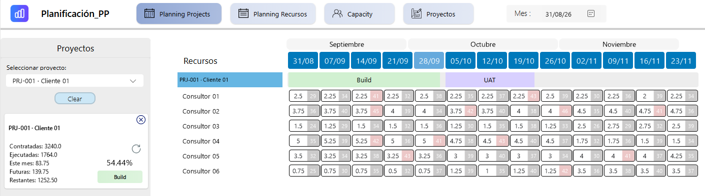
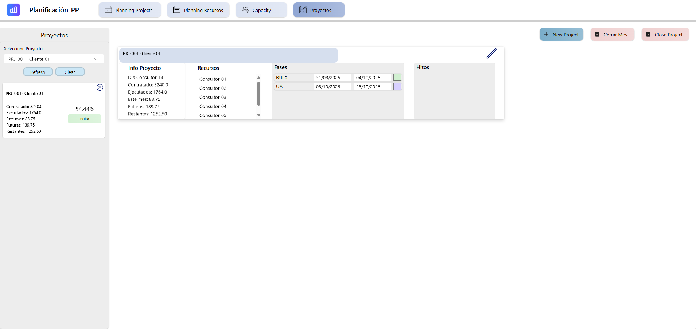
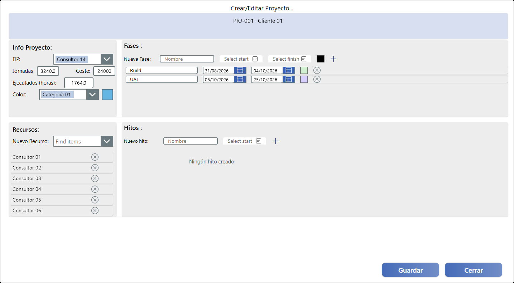
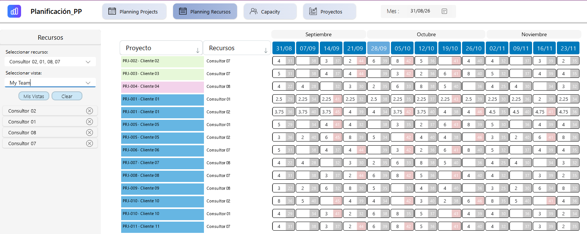
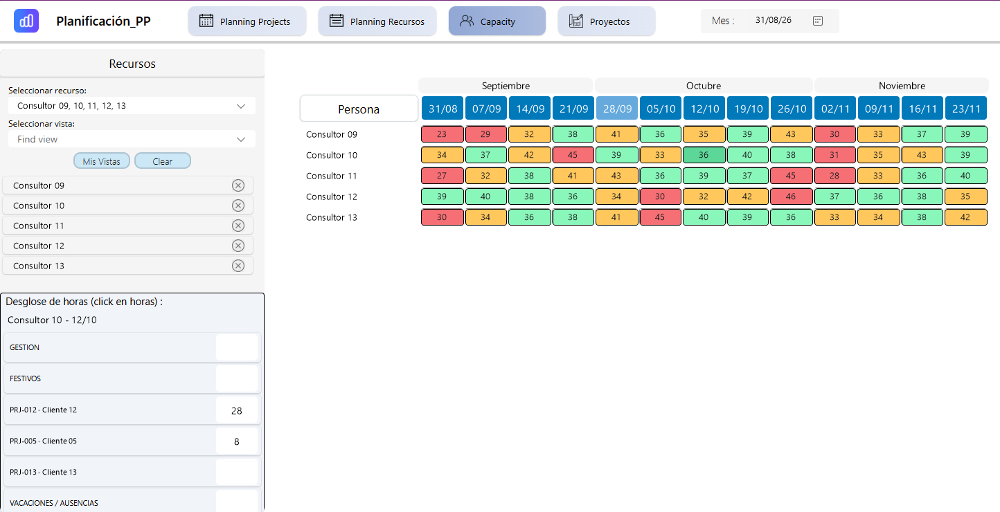
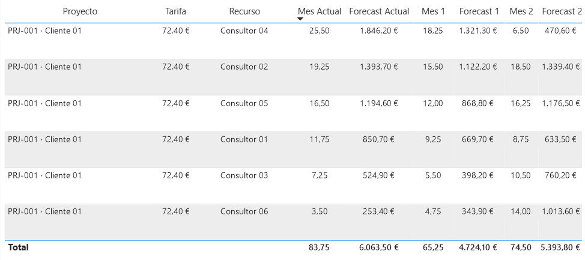

# Project Forecast & Resource Planning

During my internship at Prodware, I worked on an internal app for planning who would work on each project and how many hours they would spend on it each week. The team could check workloads in Power Apps and review those hours in a monthly Power BI forecast.

*Project planning view. The weekly grid sits below the project phases. The card on the left shows contracted, logged, and remaining hours alongside the plan.*

## The problem

Team leads wanted a quick way to log hours. The department head needed a month-end breakdown by person and project to allocate staff costs. I spoke with both sides and helped agree on the minimum detail the app had to capture. I then built the weekly entry flow around that agreement. Each entry stayed linked to a person and a project, so the team could enter hours once and use the same records for monthly reporting.

## My contribution

- I worked on the weekly calendar in Power Apps. I used Power Fx to bring in the phases, assigned consultants, and weekly hours for each selected project.
- I built a project editor that brought project details, team assignments, phases, and milestones into one form. I worked on how to save changes across the related SharePoint lists.
- I worked on the Power BI report and its data model, including how to link the imported tables for projects, consultants, assignments, and weekly hours.

## How it worked

### 1. Set up a project

The project overview pulled together the hours summary, assigned team, phases, and milestones. The pencil opened the form to edit those details.

*The editor shows the six consultants assigned to PRJ-001, its Build and UAT phases, and the controls to add a milestone.*

### 2. Plan hours by project or person

The project calendar at the top showed weekly hours for each person assigned to a selected project. The resource view let the team select people and see how their hours were split across projects.

*Consultor 01 and Consultor 02 both appear on PRJ-001 and PRJ-005. Each project assignment has its own row.*

### 3. Check team capacity

The capacity view added up weekly hours for each person. Selecting a cell opened the breakdown for that person and week.

*The grid makes weekly workloads easy to scan. The panel on the left breaks down Consultor 10's hours for the week of 12 October.*

### 4. Review the monthly forecast

The Power BI report showed planned hours next to the forecast in euros. The planned reporting window covered the current month and the next three. The capture shows the current month and the next two.

*Each forecast is planned hours multiplied by the sample hourly rate. The bottom row shows the monthly totals. All data in this report was replaced with fictional values for security and privacy.*

## Tools

| Tool | How we used it |
| --- | --- |
| Power Apps Canvas | Weekly planning, capacity view, and project editor. |
| Power Fx | Filtered the data for each selected project or person and populated the planning views. |
| SharePoint | Stored projects, consultants, assignments, phases, milestones, and weekly hours in related lists. |
| Power BI | Grouped planned hours by month and displayed the forecast in euros. |

## What I learned

I learned why each weekly planning record needs a link to both the project and the person. That made it possible to see the same hours by project or by person in Power Apps and group them by month in Power BI.

> The screenshots use fictional names, project labels, dates, hours, rates, and amounts. Dropdown arrows were restored from the original app, and empty space above the hours breakdown was trimmed in the capacity view. The app's source code is internal.
